Research notes and templates accompany a dependency-free thermal model with selectable integration methods and heat terms. The browser isolates the simplest linear balance before returning to the richer native reference.

**[Native-source lesson guide](docs/portfolio/) · [Offline interactive lab](docs/index.html) · [Lesson configuration](docs/lesson-config.json) · [Configuration schema](docs/lesson-config.schema.json)**

## Your first interactive result

1. Download or clone this repository and open `docs/index.html` in a modern browser.
2. Select **Module 1**, apply its preset, and compare the declared checkpoint with the plotted result.
3. Change one slider, inspect the model assumptions, then export the configuration or telemetry for your notes.

The browser lab runs offline with no packages, accounts, or live data feeds. Its numbers are deterministic teaching simulations. Each checkpoint states its model time and tolerance; passing it demonstrates agreement with that model, not field calibration or production readiness.

<!-- source-mapped-visuals:start -->

<details>
<summary>System topology and model boundaries</summary>



Source-defined single-state lumped formulation; not a spatial solver.

Motion is optional; the vector topology remains readable with reduced motion enabled.

</details>

<!-- source-mapped-visuals:end -->

## Four-module learning path

| Module | Investigation | Approximate time |
|---|---|---:|
| 1. Declare the thermal control volume | Identify heat input, heat rejection, and stored energy before reading a temperature curve. | 12 min |
| 2. Change thermal inertia alone | Distinguish a slower transient from a lower steady temperature. | 15 min |
| 3. Move the boundary without changing generation | Separate ambient temperature from heat input and heat-transfer conductance. | 15 min |
| 4. Choose a model and verification path | Decide which terms and numerical checks the next engineering question requires. | 18 min |

**Who this is for:** Battery and BTMS learners reviewing heat sources, boundaries, numerical methods, and validation evidence.

### Continue into the implementation

- [README.md](README.md)
- [models/README.md](models/README.md)
- [models/lumped_cell_thermal.py](models/lumped_cell_thermal.py)
- [models/data/pulse_current_profile.csv](models/data/pulse_current_profile.csv)
- [models/data/variable_cooling_profile.csv](models/data/variable_cooling_profile.csv)
- [notes/modeling-assumptions.md](notes/modeling-assumptions.md)
- [templates/thermal-parameter-traceability-matrix.md](templates/thermal-parameter-traceability-matrix.md)

### Explore or run the source

Python 3.12+ as documented for the native reference; no third-party runtime packages.

```bash
python models/lumped_cell_thermal.py --current-a 75 --duration-s 600 --integration-method exact-linear
python models/lumped_cell_thermal.py --profile-csv models/data/pulse_current_profile.csv --output-csv results/pulse_thermal_intervals.csv
python -m unittest discover -s tests -v
```

These commands come from the audited source revision. Runtime requirements and the project's own validation limits are documented below; the standalone browser lab does not execute these commands.

The detailed project guide below remains the source for installation, supported features, licences, and scientific limits. The browser equations and laboratory settings do not change the original application or numerical engine.

<details>
<summary>Project documentation, installation, attribution, and existing validation</summary>

# Battery Thermal Modeling Notes

[](https://github.com/mohammadrezwankhan/battery-thermal-modeling-notes/actions/workflows/markdown-maintenance.yml)

Research-backed notes and reproducible examples for battery thermal behavior,
BTMS design thinking, and validation assumptions.

## Documentation Map

- [Starter notes](#starter-notes) for the source-backed reading path.
- [Executable reference](#run-the-executable-reference) for a dependency-free model run.
- [Model assumptions and limitations](models/README.md) before reusing parameters or outputs.
- [Contribution entry points](#contribution-entry-points) for focused improvements.
- [Citation metadata](CITATION.cff) and [license](LICENSE) for shared work.

## Focus Areas

- Battery heat generation and thermal pathways.
- BTMS architecture comparison.
- Model assumptions and boundary conditions.
- Validation checklists for simulation claims.
- Reading notes from public literature.

## Starter Notes

- [Executable lumped cell thermal reference](models/README.md)

- [Battery thermal modeling assumptions](notes/modeling-assumptions.md)
- [BTMS architecture comparison](notes/btms-architecture-comparison.md)
- [Heat-generation model selection](notes/heat-generation-model-selection.md)
- [Thermal model limitations](notes/thermal-model-limitations.md)
- [Thermal source confidence guide](notes/thermal-source-confidence-guide.md)
- [Thermal assumptions example table](notes/thermal-assumptions-example-table.md)
- [Thermal validation example result summary](notes/thermal-validation-example-result-summary.md)
- [Battery thermal validation checklist](templates/validation-checklist.md)
- [BTMS source checklist](templates/btms-source-checklist.md)
- [Thermal validation decision log](templates/thermal-validation-decision-log.md)
- [Thermal parameter traceability matrix](templates/thermal-parameter-traceability-matrix.md)
- [Reading log template](references/reading-log-template.md)
- [Reading log: NREL Li-ion thermal characterization](references/reading-log-nrel-li-ion-thermal-characterization.md)

- [Cooling Loop Assumption Register](templates/cooling-loop-assumption-register.md)

- [Thermal Test Data Quality Checklist](templates/thermal-test-data-quality-checklist.md)

- [Cell To Pack Scaling Note](notes/cell-to-pack-scaling-note.md)

- [Ambient Boundary Condition Log](templates/ambient-boundary-condition-log.md)

- [Sensor Placement Review Template](templates/sensor-placement-review-template.md)

- [Thermal Runaway Scope Boundary](notes/thermal-runaway-scope-boundary.md)

- [BTMS Control Assumption Table](templates/btms-control-assumption-table.md)

- [Heat Rejection Pathway Map](notes/heat-rejection-pathway-map.md)

- [Validation Metric Selection Guide](notes/validation-metric-selection-guide.md)

- [Uncertainty Review Checklist](templates/uncertainty-review-checklist.md)

- [Literature Claim Extraction Template](references/literature-claim-extraction-template.md)

- [Experimental Condition Comparison](templates/experimental-condition-comparison.md)

- [Thermal Model Change Log](templates/thermal-model-change-log.md)

- [Material Property Source Register](templates/material-property-source-register.md)

- [Transient Vs Steady State Guide](notes/transient-vs-steady-state-guide.md)

- [Cooling Strategy Trade Study](notes/cooling-strategy-trade-study.md)

- [Temperature Limit Rationale Note](notes/temperature-limit-rationale-note.md)

- [Data Gap Triage Checklist](templates/data-gap-triage-checklist.md)

- [Validation Readiness Review](templates/validation-readiness-review.md)

- [Research Next Questions Log](references/research-next-questions-log.md)

## Repository Topics

```text
battery thermal-management btms bms electric-vehicles matlab simulink
research-notes battery-modeling
```

## Suggested Structure

```text
notes/
models/
figures/
references/
README.md
CONTRIBUTING.md
CITATION.cff
LICENSE
```

## Run The Executable Reference

The dependency-free lumped model implements irreversible `I^2 R` heating,
optional reversible entropic heat, a signed external heat-source profile,
linear resistance-temperature feedback,
piecewise-constant convection, an independently schedulable radiative
surroundings boundary, optional nonlinear surface radiation, explicit Euler,
exact linear, or bounded-step RK4 integration, and an energy-balance diagnostic:

```powershell
python models/lumped_cell_thermal.py --current-a 75 --duration-s 600
python models/lumped_cell_thermal.py `
  --current-a 75 --duration-s 600 --time-step-s 600 `
  --integration-method exact-linear
python models/lumped_cell_thermal.py `
  --profile-csv models/data/pulse_current_profile.csv `
  --output-csv results/pulse_thermal_intervals.csv
python models/lumped_cell_thermal.py `
  --profile-csv models/data/ambient_step_current_profile.csv `
  --output-csv results/ambient_step_thermal_intervals.csv
python models/lumped_cell_thermal.py `
  --profile-csv models/data/irregular_current_profile.csv `
  --integration-method exact-linear `
  --output-csv results/irregular_thermal_intervals.csv
python models/lumped_cell_thermal.py `
  --profile-csv models/data/reversible_heat_current_profile.csv `
  --integration-method exact-linear `
  --output-csv results/reversible_heat_intervals.csv
python models/lumped_cell_thermal.py `
  --profile-csv models/data/variable_cooling_profile.csv `
  --integration-method exact-linear `
  --output-csv results/variable_cooling_intervals.csv
python models/lumped_cell_thermal.py `
  --profile-csv models/data/external_heat_profile.csv `
  --integration-method exact-linear `
  --output-csv results/external_heat_intervals.csv
python models/lumped_cell_thermal.py `
  --profile-csv models/data/radiative_cooling_profile.csv `
  --emissivity 0.85 --radiating-area-m2 0.03 `
  --integration-method rk4 --rk4-max-step-s 0.5 `
  --output-csv results/radiative_cooling_intervals.csv
python models/lumped_cell_thermal.py `
  --current-a 75 --duration-s 600 `
  --temperature-limit-c 30 --temperature-limit-c 35 `
  --limit-report-csv results/temperature-limits.csv
python -m unittest discover -s tests -v
```

See the [model assumptions and limitations](models/README.md) before adapting
the parameters or using the output in an engineering review. The profile path
supports traceable charge/discharge duty cycles, optional interval ambient
and radiative-surroundings temperatures, entropic coefficients, and
external heat sources and heat-transfer coefficients, explicit nonuniform
interval durations, optional diffuse-gray radiation, and interval-level CSV
results. Repeatable temperature limits add first-crossing, exposure-duration,
and peak-margin summaries without changing the thermal integration.

## Scope and Limitations

This repository is a research and teaching reference. Its notes, templates, and
executable examples do not certify thermal runaway behavior, cell safety, BTMS
performance, product compliance, or an operational temperature limit. Replace
illustrative parameters with traceable project data and obtain independent
engineering, safety, and standards review before making a design or field
decision.

## Citation

If these notes or models support a paper, report, lecture, or design review, use
the machine-readable [CITATION.cff](CITATION.cff) metadata and cite the specific
note, model version, data source, and assumptions used.

## Contribution Entry Points

- Add a public reading-log entry.
- Extend the BTMS architecture comparison with source-backed examples.
- Add source-backed examples to the heat-generation model selection note.
- Add mitigation examples to the thermal model limitations note.
- Add source ranking examples to the thermal source confidence guide.
- Adapt the thermal assumptions example table for a sourced case study.
- Replace the thermal validation example summary with a sourced case study.
- Add source-backed BTMS claim examples to the BTMS source checklist.
- Improve validation checklist wording with units and boundary conditions.
- Add real project decisions to the thermal validation decision log.
- Add project-specific examples to the thermal parameter traceability matrix.
- Add project-specific examples to the cooling loop assumption register.
- Add project-specific examples to the thermal test data quality checklist.
- Add project-specific examples to the cell to pack scaling note.
- Add project-specific examples to the ambient boundary condition log.
- Add project-specific examples to the sensor placement review template.
- Add project-specific examples to the thermal runaway scope boundary.
- Add project-specific examples to the btms control assumption table.
- Add project-specific examples to the heat rejection pathway map.
- Add project-specific examples to the validation metric selection guide.
- Add project-specific examples to the uncertainty review checklist.
- Add project-specific examples to the literature claim extraction template.
- Add project-specific examples to the experimental condition comparison.
- Add project-specific examples to the thermal model change log.
- Add project-specific examples to the material property source register.
- Add project-specific examples to the transient vs steady state guide.
- Add project-specific examples to the cooling strategy trade study.
- Add project-specific examples to the temperature limit rationale note.
- Add project-specific examples to the data gap triage checklist.
- Add project-specific examples to the validation readiness review.
- Add project-specific examples to the research next questions log.
- Add a sourced temperature-limit sensitivity case study.

</details>
